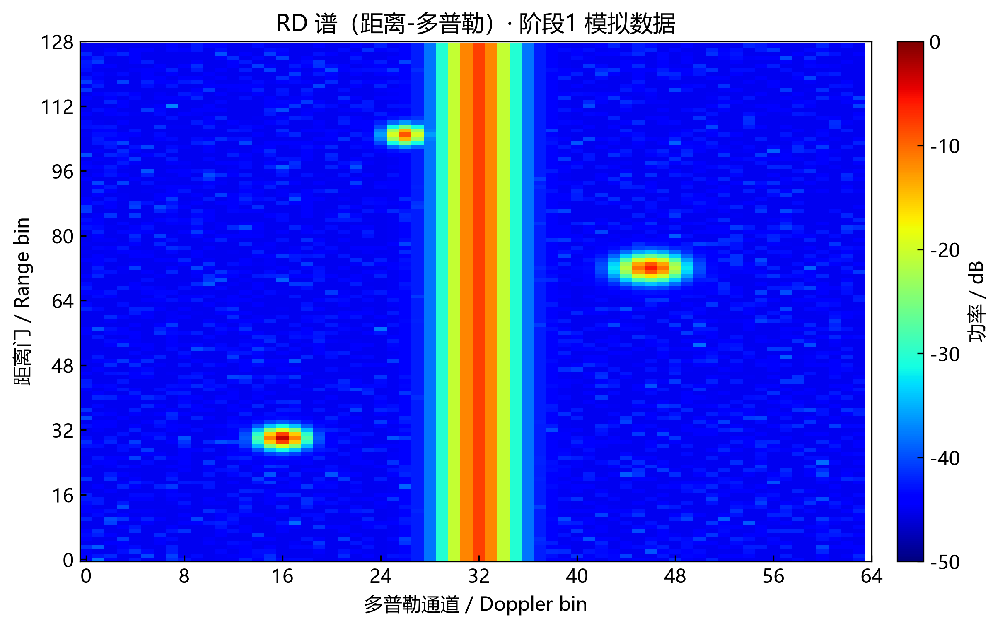
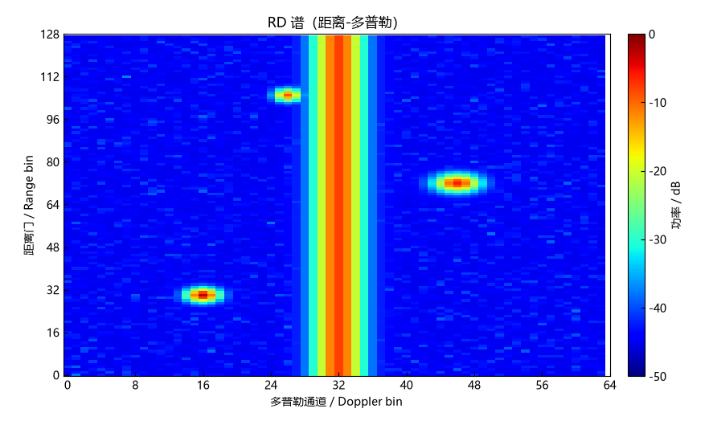

# RD 谱图上位机软件 —— 研发过程仓库

> **任务来源**：张月荣老师《上位机软件设计》群通知（2026-11-23 09:53）
> **原始要求**：研制一个软件界面，根据计算生成的 RD（距离-多普勒）谱数据，绘图显示 RD 谱图；可用 Java 或 Python（本组选 **Python**）；图形展示风格尽可能接近 MATLAB 绘制的效果。
> **负责人**：冷（华东交通大学 · 计算机 2025 级 · 上位机软件开发分工）
> **这个仓库不只是代码**，是完整的研发过程记录 + 学习笔记，组会可以直接照着讲。

---

## 一、使用本仓库的规矩（先读这条）

> **跑通 ≠ 掌握。每个知识点都要能自己讲出来。**

1. 一个阶段一个 commit，commit 历史 = 研发时间线，可直接给老师看。
2. [`docs/00-知识点地图.md`](docs/00-知识点地图.md) 是**全部知识点的台账**，逐条打勾：`✅能讲清 / 🟡半懂 / ❌不懂`。
3. 每阶段结束做文档末尾的**自测题**，不看答案能答出来才算过。
4. 组会前看本页「当前进度 + 组会汇报要点」。

## 二、技术选型（组会必问，必须会讲）

| 层 | 选型 | 为什么（要能讲出来的理由） |
|---|---|---|
| 语言 | **Python 3.13**（系统自带，非 WorkBuddy 沙箱） | 老师给定 Python；科学计算生态成熟；最终能打包成 exe 交付 |
| 界面 | **PySide6**（阶段 2 启用） | Qt 官方 Python 绑定，**LGPL 许可**，闭源/交付无法律风险；PyQt5 是 GPL / 商业双许可，交付有隐患；两者 API 几乎一致，PyQt5 教程通用；且与后续 UAV 地面站项目技术栈统一 |
| 绘图 | **Matplotlib** + `FigureCanvasQTAgg` | 唯一能精细控制色表 / colorbar / 坐标轴、又能嵌进 Qt 窗口的成熟方案，最接近 MATLAB |
| 数据 | **NumPy**（视接口再加 SciPy） | RD 谱本质就是一个二维矩阵 |
| 打包 | **PyInstaller**（阶段 5） | 交付 .exe，老师电脑不用装 Python |

**几个"为什么不用"**（老师很可能追问）：
- 不用 PyQt5：许可证 + 非官方维护，见上表。
- 不用 Matplotlib 独立弹窗：要做的是**软件界面**，需要按钮、文件选择、布局，必须有 GUI 框架托管。
- 不一次装全套依赖：阶段 1 只需要 numpy + matplotlib（约 30MB），PySide6 约 150MB，等用到再装，出问题好定位。

## 三、研发路线（6 阶段，一步步来）

| 阶段 | 内容 | 状态 | commit |
|---|---|---|---|
| 0 | 立项：仓库骨架、环境、接口确认清单 | ✅ 2026-11-23 | 见 git log |
| 1 | 后端跑通：模拟 RD 数据 + MATLAB 风格出图 | ✅ 2026-11-23 | 见 git log |
| 2 | PySide6 主窗口 + 布局 + 信号与槽 | ✅ 2026-11-23 | `18c32f4` / `baac67d` |
| 3 | FigureCanvasQTAgg 图表嵌入 + 按钮触发 | ✅ 2026-11-24 | `ff03029` |
| 4 | 多格式数据接入 + QThread 防界面卡死 | ✅ 2026-11-24 | 本次提交 |
| 5 | PyInstaller 打包 exe + 组会材料 | ⬜ 未开始 | |

> 顺序依据：**先后端、后前端**。先保证"数据能读、图能画对"，再套界面，出问题时能一眼定位是数据问题还是界面问题。

## 四、阶段 0-2 成果



| 文件 | 作用 | 阶段 |
|---|---|---|
| `01_backend/make_fake_rd.py` | 造一份"像真的"模拟 RD 谱：噪声底 + 3 个动目标 + 零多普勒杂波带 | 1 |
| `01_backend/plot_rd_demo.py` | 读数据 → 画 MATLAB 风格伪彩图 → 保存 png | 1 |
| `02_ui/main_window.py` | PySide6 主窗口：点按钮选文件 → 标签显示文件名 → 状态栏反馈 | 2 |
| `docs/02-阶段1-学习笔记.md` | **逐行讲代码** + 每个知识点 + MATLAB 对照表 + 自测题答案 | 1 |
| `docs/03-阶段2-学习笔记.md` | 事件循环 / 信号槽 / 布局逐段讲 + 6 道自测题 | 2 |
| `03_embed/rd_viewer.py` | **当前主程序**：RD 图嵌进窗口，选文件即刷新 | 3 |
| `01_backend/rd_data.py` | 唯一数据入口（脚本+界面共用） | 3 |
| `docs/04-阶段3-学习笔记.md` | Figure/Canvas/刷新机制逐段讲 + 6 道自测题 | 3 |
| `04_thread/rd_viewer_threaded.py` | **当前主程序**：多格式接入 + QThread 后台读文件不卡界面 | 4 |
| `docs/06-代码词词典.md` | 每个英文词拆到词根（字面意思 / 干嘛 / 改了会怎样） | 贯穿 |
| `docs/07-阶段4-学习笔记.md` | 多格式分派 / QThread / 跨线程信号 逐段讲 + 7 道自测题 | 4 |

**当前可用软件**（阶段 4，推荐跑这个——多格式 + 防卡死 + 换电脑自动造数据）：
```bash
.venv\Scripts\python.exe 04_thread\rd_viewer_threaded.py
```
启动即显示默认 RD 图；点「选择 RD 数据文件」可换 .npy / .csv / .txt / .mat（读 .mat 才需装 scipy）。读大文件时界面不卡；换电脑 clone 下来没数据会自动造一份。



运行（先进入本仓库根目录）：
```bash
cd /d D:\WorkBuddyWorkspace\2026-11-23-12-10-51\rd-spectrum-viewer
.venv\Scripts\python.exe 01_backend\make_fake_rd.py
.venv\Scripts\python.exe 01_backend\plot_rd_demo.py
```
> `cd /d` 的 `/d` 是 CMD 专用：同时切**盘符**和目录。只写 `cd D:\xxx` 不会切到 D 盘，相对路径仍会在 C 盘找，报「系统找不到指定的路径」。PowerShell / Git Bash 不需要 `/d`。

💡 懒得切目录也行，**全绝对路径一步到位**（任何目录下都能跑，脚本靠 `__file__` 自己定位 `data/` 和 `docs/`）：
```bash
D:\WorkBuddyWorkspace\2026-11-23-12-10-51\rd-spectrum-viewer\.venv\Scripts\python.exe D:\WorkBuddyWorkspace\2026-11-23-12-10-51\rd-spectrum-viewer\01_backend\plot_rd_demo.py
```

## 五、环境搭建：掌握规则与从零复现

**规则**：环境分三档 —— 概念必须会讲（组会必问）、命令必须会复现（换电脑/现场演示）、网络排错不用练（本机噪音）。详见知识点地图 K0.1~K0.6。本次由 WorkBuddy 代装，**不要求删了重装**；**从阶段 2 起，新增依赖由负责人亲手敲命令**。

换一台 Windows 电脑，从零到出图只有四条命令（每条含义见知识点地图）：
```bash
py -3.13 -m venv .venv
.venv\Scripts\python.exe -m pip install -r requirements.txt -i https://pypi.tuna.tsinghua.edu.cn/simple
.venv\Scripts\python.exe 01_backend\make_fake_rd.py
.venv\Scripts\python.exe 01_backend\plot_rd_demo.py
```

本机环境实测（2026-11-23）：Python 3.13 在 `C:\Users\ASUS\AppData\Local\Programs\Python\Python313`；git 2.55；GitHub **SSH 认证成功**、HTTPS 直连不通，故 push 走 `git@github.com:...`；无 `gh` CLI、无 token。

## 六、组会汇报要点（阶段 0-4）

1. **选型理由**：PySide6 / Matplotlib / NumPy 各自为什么（见第二节表格）。
2. **进展**：① 后端 MATLAB 风格 RD 谱出图；② PySide6 主窗口（事件循环 + 信号槽）；③ 图嵌进窗口，选文件即刷新；④ **多格式数据接入 + QThread 后台读文件，界面不卡**。
3. **数据模型**：RD 谱 = 距离维 × 多普勒维的二维功率矩阵，颜色表示功率（dB）。
4. **风险控制**：数据接口未定，读取逻辑收敛到 `rd_data.py` 的 `load_rd()` **唯一入口**，按后缀分派 .npy/.csv/.txt/.mat；脚本+界面共用，真数据来了只改对应分支。
5. **程序结构转变**：脚本（跑完就退）→ 窗口（事件循环）→ 图形软件（Canvas 嵌入）→ **多线程软件（读文件进 QThread，信号送回主线程画图）**。
6. **QThread 关键话术**：它不是让读文件变快，是让界面在读的时候还能响应；工作线程绝不碰 UI，用 Signal 把数组送回主线程再画。
7. **技术债已清**：`data/` 不进仓库的坑用 `_ensure_default_data()` 现场造数据兜底，换电脑 clone 即可运行。
8. **下一步**：PyInstaller 打包 exe + 组会材料；真接口待算法组确认（6 问清单已备）。

## 七、待办 / 阻塞

- [ ] ⚠️ **找负责生成 RD 数据的同学确认接口** → 已备好可直接复制的提问清单：[`docs/01-接口确认清单.md`](docs/01-接口确认清单.md)
- [x] ~~网页新建 GitHub 远程仓库并首次 push~~ ✅ 已完成：`https://github.com/len536/rd-spectrum-viewer`（19 个 commit 已同步）

## 八、目录约定

```
rd-spectrum-viewer/
├── README.md              项目总览 / 路线 / 开发日志 / 组会要点
├── requirements.txt       分阶段依赖（按阶段取消注释）
├── .gitignore
├── docs/
│   ├── 00-知识点地图.md     ★ 全部知识点台账 + 掌握标准 + 自测题
│   ├── 01-接口确认清单.md   ⚠️ 必须向数据同学确认的问题
│   ├── 02-阶段1-学习笔记.md 逐行讲解 + MATLAB 对照 + 答案
│   ├── 03-阶段2-学习笔记.md 事件循环 / 信号槽 / 布局 + 自测题
│   ├── 04-阶段3-学习笔记.md Figure/Canvas/刷新机制 + 自测题
│   ├── 07-阶段4-学习笔记.md 多格式 / QThread / 跨线程信号 + 自测题
│   ├── 06-代码词词典.md     ★ 每个英文词拆根（看不懂就查这里）
│   └── images/             出图成果（进仓库，组会直接展示）
├── 01_backend/            阶段1+3+4：纯脚本 + 数据入口
│   ├── make_fake_rd.py
│   ├── plot_rd_demo.py
│   └── rd_data.py         ★ 唯一数据入口（多格式分派，脚本+界面共用）
├── 02_ui/                 阶段2：PySide6 主窗口骨架
├── 03_embed/              阶段3：RD 图嵌入窗口
├── 04_thread/             阶段4：★ 当前主程序（多格式 + QThread 防卡）
├── data/                  运行时生成的模拟数据（gitignore，可自动重造）
└── .venv/                 虚拟环境（gitignore）
```
后续阶段的目录（如 `04_thread/`）随进度新建 —— **让仓库跟着项目一起长大**，这本身就是研发过程记录。
